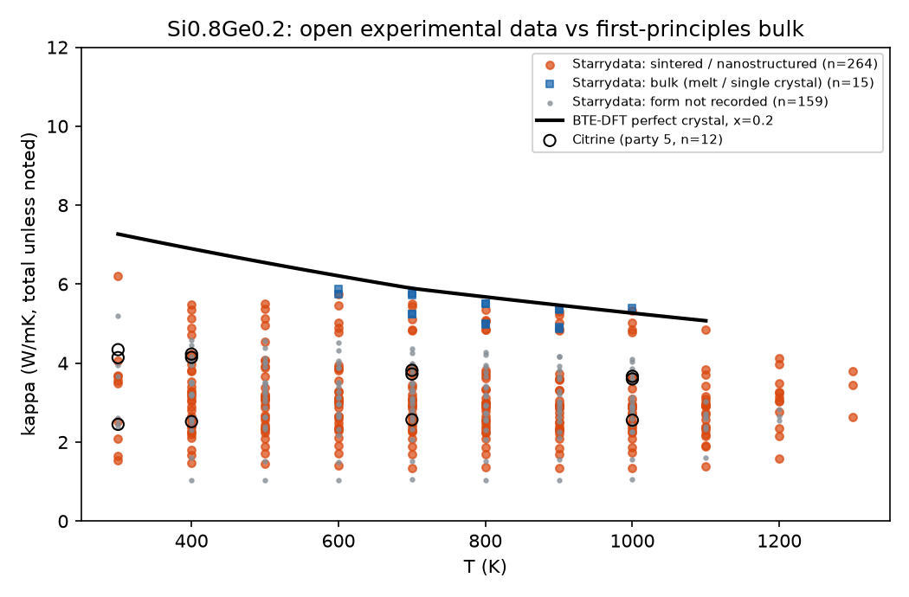

# Open experimental data: parties DB-STARRY and DB-UCSB (2026-09-29)

Constraint (2026-09-29): the group has no archived SiGe data and no budget
for physical-instrument measurements, so the experimental party must come
from open sources. This folder replaces an earlier plan based on five
paywalled PDFs and new pellet measurements.

## Sources

| Party | Source | Pinning | Per-point upstream |
|---|---|---|---|
| DB-STARRY | Starrydata2 (NIMS), GitHub release `starrydata/starrydata_datasets`, immutable tag `data-20260928` (was fetched as "latest" on 2026-09-29; same files), manifest generated 2026-09-28T23:13Z | sha256 of `all_curves/all_samples/all_papers.csv.gz` in `ingest_open_db.py`; the SiGe slice is committed verbatim in `raw/` because the release is regenerated daily | DOI, sample id, figure id; DOIs resolved to Semantic Scholar corpusIds through Asta (`asta_doi_resolution.json`, 38/38 resolved) |
| DB-UCSB | UCSB/MRL thermoelectrics (Gaultois et al.), matminer `ucsb_thermoelectrics`, figshare 28333845 | sha256 `7d0c9c74...` | DOI per row |

Starrydata2 is released for open reuse by its maintainers; cite the dataset
paper (Katsura et al., Sci. Technol. Adv. Mater.: Methods 2025,
10.1080/27660400.2025.2506976) and the upstream DOI of every curve used.
**Licence (confirmed 2026-10-11):** the Starrydata
and Starrydata2 database is published under CC BY 4.0, and its Python
loader (PyPI `starrydata`) under the MIT License. The committed slice in
`raw/` may therefore be redistributed with attribution. Cite one of
Katsura et al., Sci. Technol. Adv. Mater.: Methods 5, 2506976 (2025),
10.1080/27660400.2025.2506976 (used in P1-P3), or Katsura et al., Sci.
Technol. Adv. Mater. 20, 511-520 (2019), 10.1080/14686996.2019.1603885,
and, where needed, the original source paper of each curve (DOIs in
`raw/`). Both DOIs checked against Crossref 2026-10-11.

Superseded licence check 2026-10-04 (kept for the record): the GitHub repository `starrydata/starrydata_datasets` declares no licence (GitHub API `license: null`, no licence text in its README), and the NIMS web page states none. The maintainers' own 2019 snapshot on figshare (DOI 10.6084/m9.figshare.11340935) is CC BY 4.0. Until the maintainers confirm terms for the GitHub release, the deposit should hold the slice hashes and the retrieval script rather than redistribute `raw/`; P1's data availability statement says so. Feyn 3.5.0 (PyPI) is CC-BY-NC-ND-4.0.

**Release update 2026-10-04 (campaign-record entries 92-95, `../version_bump/`):** the SiGe slice of tag `data-20261003` is byte-identical to the committed `data-20260928` slice, so the pin was moved with an empty blast radius. The ingester still fetches the original immutable tag; both tags give the same `raw/` files.

## What came in (`INGEST_SUMMARY.json`)

- 529 SiGe thermal-conductivity curves in the Starrydata slice. In scope
  after the entry rules: diamond-lattice Si(1-x)Ge(x) with < 2 at% dopants.
  Excluded: 119 composites (FeSi2, WSi2, oxide or nano-inclusion
  composites), 254 with non-dopant elements (Mg2(Si,Ge), MnSi, etc.), 13
  re-plotted "Reference" curves (duplicates by construction), 12 with no
  stoichiometry ("SiGe"), 15 heavily doped.
- **645 live points from 37 papers**, sampled from each curve at
  300-1300 K in 100 K steps without extrapolation. By sample class:
  354 sintered / nanostructured, 32 bulk (melt or single crystal),
  15 nanowire, 2 film, 242 form not recorded. 592 are total kappa
  (includes the electronic part in doped thermoelectric samples; flagged
  `kappa_type` on every point), 53 lattice kappa.
- Composition coverage is Si-rich only (x = 0.004 to 0.40). This is the
  thermoelectric (RTG-lineage) window; the Ge-rich side still rests on
  the simulation parties.
- DB-UCSB adds no new points: all 12 in-scope rows are numerically
  identical to rows already in the Citrine party. They do something
  better: they supply the DOIs Citrine lacks. Citrine's SiGe rows trace to
  Joshi et al. 2008 (10.1021/nl8026795) and Vining et al. 1991
  (10.1063/1.348408). Both flags and resolutions are in the summary.
- Dedup against the literature party by corpusId: no overlap (the LLM
  literature party and Starrydata read different papers).

## Physical-bound screen (`screen_and_plot.py`, `SCREEN_SUMMARY.json`)

Standing rule since the MACE unit slip: before ingestion, a new party's
points are checked against a bound the existing parties imply. Here the
bound is the perfect-crystal first-principles value (BTE-DFT, party 4a):
kappa must not exceed 1.3 x BTE + 1.5 W/mK (the offset allows for the
electronic part of total kappa). **0 of 645 points exceed it.**



The materials result at x = 0.2 (the RTG composition), relative to the
BTE-DFT perfect crystal at the same x and T:

| Sample class | Points | Papers | kappa / BTE (10th, 50th, 90th pct) |
|---|---|---|---|
| bulk (melt-grown) | 15 | 1 | 0.88, 0.95, 0.98 |
| sintered / nanostructured | 249 | 12 | 0.33, 0.50, 0.81 |
| form not recorded | 156 | 13 | 0.33, 0.51, 0.70 |

Two readings. (1) The one melt-grown bulk series sits within 5% of the
first-principles line, an independent experimental check of party 4a
(one paper only, so it is a check, not a calibration). (2) Sintered,
nanostructured samples conduct about half as well as the perfect
crystal, with a wide spread: grain-boundary scattering is the dominant
variable, which is exactly P1's proposed discovery question.

## Limits and the remaining open route

- **Grain size is not in Starrydata's structured metadata** (the field is
  empty for every SiGe sample). For P1's grain-size axis it must be read
  from the upstream papers; the Asta snippet/full-text route (as used for
  the literature party) is the open way to do that for open-access papers.
- **Abeles 1963, Dismukes 1964 and Cheaito 2012 are in no open database.**
  Cheaito 2012 has an open repository copy (Unpaywall); the 1960s bulk
  data survive in open form only where later open-access papers quote or
  re-plot them. Asta snippet search q53 was the first pass; no clean
  table turned up. The melt-grown Starrydata series and the BTE-DFT party
  stand in for the bulk reference meanwhile.
- **One carbon-containing SiGe curve exists in open data:** Si80Ge20C6,
  Ovsyannikov et al., Phys. Solid State 2015 (10.1134/s1063783415030208,
  Asta-verified), kappa about 1.5 W/mK at 370-700 K. It is a nanocomposite
  (6 at% C, far above substitutional solubility), so it does not close the
  "no kappa data for substitutional C in SiGe" gap, but any
  SiGe(C) claim must cite it. Excluded here by the dopant rule.
- These points are not yet joined to the evidence hypergraph; joining is
  a one-line addition to `pilot/kg/extract_kg.py` once the party is
  accepted.

## Reproduce

```
~/mat_theory_pilot/venv/bin/python ingest_open_db.py          # from raw/
~/mat_theory_pilot/venv/bin/python ingest_open_db.py --fetch  # refetch; fails on any hash change
~/mat_theory_pilot/venv/bin/python screen_and_plot.py
```

## Review-article sources (2026-09-30)

20 live points come from two review articles that re-plot other papers' data
(flagged in `papers/bib_audit/DATA_SOURCES_AUDIT.md`). Both are paywalled
(Unpaywall: no open-access copy); the plotted curves were traced to their
primary papers from copies of the two reviews (below).

| Review | DOI link | Starrydata points |
|---|---|---|
| M. S. Dresselhaus, G. Chen, M. Y. Tang, R. Yang, H. Lee, D. Wang et al., "New Directions for Low-Dimensional Thermoelectric Materials", Adv. Mater. 19, 1043-1053 (2007) | https://doi.org/10.1002/adma.200600527 | 19: Fig. 9 (samples 26769, Si0.80Ge0.20B0.016, 8 pts; 26770, Si80Ge20B1, 2 pts) and Fig. 11 right (sample 26771, Si0.80Ge0.20B0.016, 9 pts), 300-1200 K |
| A. Shakouri, "Recent Developments in Semiconductor Thermoelectric Physics and Materials", Annu. Rev. Mater. Res. 41, 399-431 (2011) | https://doi.org/10.1146/annurev-matsci-062910-100445 | 1: Fig. 7 (sample 26819, Si0.9Ge0.1, 300 K, 9.43 W/mK) |

### Trace result (2026-09-30)

| Starrydata sample | Review figure | Primary source named in the caption | Status |
|---|---|---|---|
| 26769, 26770 (Fig. 9) | "experimental measurements on two nanocomposite samples" (JPL ball-milled sample SGMA05, p-type Si0.80Ge0.20B0.016, 96 h milling) | ref. [13]: M. S. Dresselhaus, G. Chen, M. Y. Tang, R. G. Yang, H. Lee, D. Z. Wang, Z. F. Ren, J. P. Fleurial, P. Gogna, in *Materials and Technologies for Direct Thermal-to-Electric Energy Conversion*, MRS Symp. Proc. (Eds. J. Yang, T. P. Hogan, R. Funahashi, G. S. Nolas), MRS, Pittsburgh 2005, pp. 3-12 | primary is conference proceedings, not in any open database; no duplicate in this party (Joshi 2008, 10.1021/nl8026795, is a different sample set). **Keep**, relabel as proceedings-grade provenance |
| 26771 (Fig. 11 right) | ball-milled 96 h p-type Si0.80Ge0.20B0.016 nanocomposite vs bulk RTG alloy | refs. [13] and [59]: R. Yang, G. Chen, *Mater. Integr.* 18, 31 (2005) | same as above; **keep**, proceedings/trade-journal provenance |
| 26819 (Fig. 7) | the "Si0.9Ge0.1 bulk alloy" reference curve in a superlattice cross-plane plot | ref. 101: Huxtable et al., *Appl. Phys. Lett.* 80, 1737 (2002), DOI 10.1063/1.1455693 (plus ref. 103, X. Fan PhD thesis, UCSB 2001) | primary paper is already in this party (sample 45043, Si0.8Ge0.2 at 5.19 W/mK), but as a different curve and composition, so not a numerical duplicate. **Keep**, repoint upstream to Huxtable 2002 |

No point is dropped: none of the 20 duplicates a row already in the party.
The caveat changes from "secondary source" to "primary is proceedings-grade
(19 points) or already-represented paper, different curve (1 point)".
Caption text extracted with `pdftotext`; the PDFs are copies supplied by
the authors and are not redistributed.
