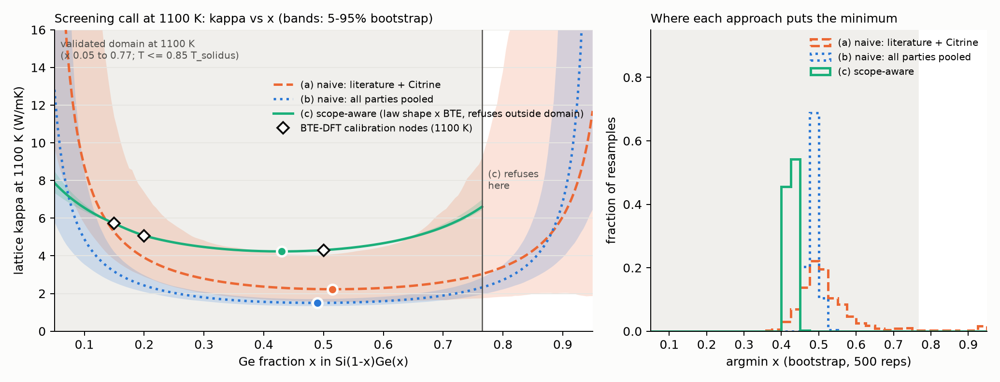

# P1 screening-decision demo: which SiGe composition minimizes lattice kappa?

Run 2026-09-29. This is the decision demo that the audit
(`papers/notes/03_audit_and_verdicts_2026-09-29.md`, section 2) asks for. It uses
no new compute. Reproduce with
`~/mat_theory_pilot/venv/bin/python phase_c/screening_demo/screening_demo.py`
(about 4 s on CPU, fixed seed 20260929, bit-identical `results.json` on
rerun). The campaign record was read and not written.

## 1. The decision

A thermoelectric designer wants to know which Si(1-x)Ge(x) composition
window gives the lowest lattice thermal conductivity kappa at 1100 K, a
typical hot-side temperature for a SiGe leg. The same question is also
asked at 300 K and 700 K. The candidates are x = 0.05, 0.10, ..., 0.95.
For each approach we report:

- the argmin x (the minimum on a 0.005 grid) and the best candidate;
- the predicted kappa_min;
- the decision window, meaning all x with kappa <= 1.10 kappa_min;
- whether the answer lies in a validated domain.

## 2. The three approaches

**(a) Naive, literature plus database.** One least-squares fit of
1/kappa = a + b x + c x^2 + d T, the same functional family as the final
law. It is fitted on the literature party exactly as first extracted (67
rows: no second-extractor corrections, non-SiGe rows kept, no
sample-class labels) plus the 17 Citrine rows. Literature rows without a
temperature are assigned 300 K, the usual naive default. Rows without x
cannot be used, which leaves 59 rows.

**(b) Naive, everything pooled.** The same fit on every party with no
party or scope distinction (154 rows):

- the literature as extracted;
- Citrine;
- the CHPC-MD raw finite-size rows, DGX-MD and MACE-MD;
- BTE-DFT, including the pure-Si and pure-Ge endpoints;
- the 42 extrapolated Tersoff bulk series behind the final law.

**(c) Scope-aware.** This approach uses three pieces of the project's
machinery:

- **Shape.** The final law's shape (`phase_c/final_law/final_law.json`).
  It was fitted by HG-SR on the post-operation CHPC-MD state:
  1/kappa = 0.2092 + 1.919 x + 8.35e-5 T - 2.244 x^2.
- **Absolute scale.** The first-principles BTE-DFT party supplies it
  through a per-regime multiplicative scope correction
  r(x, T) = kappa_BTE / kappa_law. The correction is taken at the BTE
  nodes inside the domain, interpolated log-linearly in x, and held flat
  beyond the outermost node. At 1100 K the correction factor is
  3.02-3.08; at 300 K it is 3.84-4.11 for x <= 0.5 and 2.81 at x = 0.85.
- **Refusal.** Approach (c) returns no answer outside the validity domain
  x in [0.05, 0.90], T <= 0.85 T_solidus(x). The domain comes from the
  Ge-corner scope-limit at campaign record seq 28. At 1100 K the premelting bound
  already caps x at 0.765, so (c) refuses x = 0.80-0.95 at 1100 K and
  x = 0.95 at 300 K and 700 K.

In (c) the literature enters only as the corrected bulk-scope rows, and
only as a check (section 5). These are the rows left after campaign record seq
20-23 (scope-limit of 13 non-SiGe rows, forget 2, correct 1,
quarantine 12) and the stage-0 sample-class split.

## 3. Results

| Approach | T (K) | argmin x (best candidate) | kappa_min (W/mK) | Decision window (x) | Bootstrap argmin x, 5-95% | Bootstrap kappa_min, 5-95% | kappa(0.20)/kappa_min | Validated domain |
|---|---|---|---|---|---|---|---|---|
| (a) naive lit+DB | 300 | 0.515 (0.50) | 1.39 | 0.335-0.700 | 0.43-0.68 | 1.02-1.99 | 1.37 | none declared, never refuses |
| (a) naive lit+DB | 700 | 0.515 (0.50) | 1.71 | 0.355-0.680 | 0.43-0.68 | 1.24-2.49 | 1.50 | none declared |
| (a) naive lit+DB | 1100 | 0.515 (0.50) | 2.23 | 0.375-0.660 | 0.43-0.68 | 1.49-4.00 | 1.75 | none declared |
| (b) naive pooled | 300 | 0.490 (0.50) | 1.12 | 0.325-0.650 | 0.47-0.51 | 0.98-1.26 | 1.40 | none declared |
| (b) naive pooled | 700 | 0.490 (0.50) | 1.28 | 0.340-0.640 | 0.47-0.51 | 1.17-1.41 | 1.48 | none declared |
| (b) naive pooled | 1100 | 0.490 (0.50) | 1.50 | 0.350-0.625 | 0.47-0.51 | 1.33-1.71 | 1.62 | none declared |
| (c) scope-aware | 300 | 0.395 (0.40) | 6.25 | 0.240-0.690 | 0.39-0.61 | 6.10-6.31 | 1.16 | yes (x <= 0.90) |
| (c) scope-aware | 700 | 0.600 (0.60) | 4.88 | 0.270-0.730 | 0.58-0.62 | 4.76-4.96 | 1.21 | yes (x <= 0.90) |
| (c) scope-aware | 1100 | 0.430 (0.45) | 4.24 | 0.260-0.595 | 0.42-0.44 | 4.20-4.26 | 1.20 | yes (x <= 0.765) |

The naive fits use one quadratic in x for 1/kappa, so their argmin is
the same at every T by construction. The full candidate rankings are in
`results.json`. Figure: `fig_screening.png`. The left panel shows kappa(x)
at 1100 K with 5-95% bootstrap bands, the BTE calibration nodes, and the
shaded validity domain. The right panel shows the bootstrap argmin
distributions.

## 4. Findings

**The composition call barely changes.** All three approaches put the
minimum near the middle of the alloy range: x = 0.43 for (c), 0.49 for
(b) and 0.515 for (a) at 1100 K. The decision windows overlap over
x = 0.375-0.595. Naive (a) is 0.085 in x from (c), and its window is
shifted Ge-ward by about 0.07-0.1. Reported plainly, the argmin shift is
small and sits inside (c)'s own window. No approach picks an endpoint
composition at its point estimate. Naive (a) does so in 2% of bootstrap
resamples, which put the minimum at x >= 0.85. This is expected
physically: mass-disorder scattering gives a broad, flat, mid-range
minimum, and even poor data find the middle of a bowl.

**The magnitude and the temperature trend differ a lot, and these drive
the design.**

- *Absolute kappa.* At 1100 K the naive approaches predict
  kappa_min = 2.23 W/mK (a) and 1.50 W/mK (b), against 4.24 W/mK for
  (c). They are low by 2.0 W/mK (47%) and 2.7 W/mK (65%). At 300 K they
  are low by 78% and 82% (1.39 and 1.12 against 6.25 W/mK). The naive
  numbers come from averaging amorphous, nanowire, film and Tersoff-MD
  values into a "bulk" curve. Because zT scales as 1/kappa, a designer
  who took the naive value would overestimate the lattice-limited zT by
  up to about 2x at 1100 K.
- *Temperature trend has the wrong sign.* Both naive fits have d < 0, so
  they predict that kappa_min rises with temperature (+60% from 300 to
  1100 K for (a), +35% for (b)). Scope-aware (c) gives the physical
  Umklapp decrease: -32%, from 6.25 to 4.24 W/mK. The sign error comes
  from the naive T = 300 K imputation mixing with pooled reduced-dimension
  rows. Dropping the untimed rows instead of imputing gives a nearly flat
  T trend (2.02 to 2.13 W/mK), still at the wrong level. In the ablation
  (section 6), the bulk scope split is the operation that turns the
  literature fit's T-slope physical.
- *Cost of the Si-rich choice.* RTG legs use x = 0.20. The naive fits
  say x = 0.20 costs 62-75% more lattice kappa than the optimum at
  1100 K. Approach (c) says 20% (16% at 300 K). This is a real design
  difference: it changes how much a designer should be willing to pay
  in Ge cost and density to move toward mid-range compositions.

**Naive pooling is confidently wrong.** Pooling everything gives the
tightest bootstrap argmin band (x = 0.47-0.51) and a tight kappa_min
band (1.33-1.71 W/mK at 1100 K). That band excludes the first-principles
and experimental values by a factor of about 3. The 42 dense Tersoff
series dominate the pooled fit, and their measured alloy bias is a
factor of about 3.3 (final-law comparison). More data from a biased
party buys precision, not accuracy.

**Refusal.** At 1100 K, (c) declines to rank x = 0.80-0.95, which lie
above 0.85 T_solidus. It also declines x = 0.95 at every T. The naive
fits rank all 19 candidates. At 1100 K they return kappa(0.95) = 11.7 and
86 W/mK from extrapolation. Refusal does not move the argmin here,
because the minimum is interior. Its value is that no number is issued
where the evidence cannot support one.

**Uncertainty of the scope-aware answer is in the calibration, not the
law.** The (c) bootstrap resamples the 42 law rows and reruns HG-SR term
selection in each replicate. The selected form varied: 1+x+T+x^2 in
282/500, 1+x+1/T+x^2 in 125, 1+x+x^2 in 88. Even so, the band is narrow
(x = 0.42-0.44 at 1100 K), because the law's shape is well determined.
The BTE calibration is the weak link. There is one deterministic
calculation per node and only 3-4 nodes per temperature.

- Leaving one node out moves the argmin between x = 0.395 and 0.495 at
  300 K, and between 0.415 and 0.60 at 700 K.
- A single median factor per temperature puts it at 0.43 everywhere.
- The 700 K argmin of 0.60 is an artifact of interpolating toward the
  x = 0.85 node, where the correction falls to 2.17.
- At 1100 K all variants give 0.43-0.44 and 4.24-4.25 W/mK.

So the defensible scope-aware output is **the window x = 0.26-0.60 at
1100 K, with kappa_min about 4.2 W/mK**. The argmin point is not the
deliverable. The bootstrap bands for (c) do not include the calibration
uncertainty; the node-dropping sensitivity does, and it is in
`results.json` under `sensitivity`.

## 5. Check against real SiGe knowledge

The classic measurements (Abeles 1963; Dismukes et al. 1964) give bulk
alloy lattice kappa with a broad, flat minimum over roughly
x = 0.3-0.7, at about 5-9 W/mK at 300 K for undoped crystals.

- **Scope-aware (c) matches.** At 300 K it gives 6.25 W/mK at x = 0.40
  with a window of x = 0.24-0.69: inside the experimental band, with the
  same flat bottom.
- **Naive (a) and (b) do not.** At 300 K they give 1.1-1.4 W/mK. That is
  a factor of 4-6 below bulk experiment and close to the amorphous or
  nanostructured SiGe range, which is where the contaminating rows come
  from.
- **Point checks.** The corrected bulk literature rows at x = 0.2,
  300 K (kg rows 34 and 35, both 9 W/mK) sit 24% above (c)'s 7.27 W/mK.
  The Citrine x = 0.5, 300 K value of 7.1 W/mK is 9% above (c)'s
  6.49 W/mK.
- **Doped Si0.8Ge0.2.** The Citrine x = 0.2 rows are mostly doped
  thermoelectric material: 2.4-4.3 W/mK at 300 K and 2.6-3.7 W/mK at
  1000 K. They lie 30-66% below (c). This is expected. BTE-VCA contains
  only mass disorder, with no dopant, grain-boundary or short-range-order
  scattering, so (c) describes undoped, coarse-grained crystals and is an
  upper reference for engineered legs. It does not predict those legs.

The practical x = 0.20 choice for RTG legs is not a kappa optimum under
any approach. It trades about 20% higher lattice kappa (by (c)) for
higher carrier mobility, lower Ge cost and lower density. That is the
known engineering rationale, and (c) quantifies the price correctly
while the naive fits overstate it about 3-fold.

## 6. Value of the shard operations (ablation, 1100 K)

The operations are added cumulatively, starting from naive (a).

| Step | Rows | argmin x | kappa_min (W/mK) | Window | T-trend of kappa_min, 300 to 1100 K |
|---|---|---|---|---|---|
| 0 naive (a) | 59 | 0.515 | 2.23 | 0.375-0.660 | rises (+60%, wrong sign) |
| 1 + scope-limit 13 non-SiGe rows, forget 2 absent values (seq 20, 21) | 54 | 0.530 | 1.98 | 0.385-0.670 | rises (+61%) |
| 2 + correct row 34 x, quarantine 12 unattributable rows (seq 22, 23) | 42 | 0.590 | 1.62 | 0.420-0.755 | rises (+19%) |
| 3 + sample-class split, keep literature-bulk (stage 0) | 36 | 0.505 | 2.20 | 0.345-0.665 | falls (-13%, physical sign) |
| 4 + Ge-corner scope-limit x <= 0.90 (seq 28) | 34 | 0.470 | 2.28 | 0.320-0.620 | falls (-13%) |
| 5 replace literature fit by the final-law shape (no calibration) | 42 series | 0.430 | 1.41 | 0.260-0.595 | falls (-9%) |
| 6 + BTE-DFT per-regime calibration = (c) | 42 series + BTE | 0.430 | 4.24 | 0.260-0.595 | falls (-32%) |

What each revision buys:

- **Literature value audit (steps 1-2).** It moves the argmin by up to
  0.075 and removes 17 rows (5 of them in the alloy range), but it does
  not fix the level. After it, only 19 literature rows fall in x = 0.05-0.90, which
  is too few, and too heterogeneous, to carry a law.
- **Bulk scope split (step 3).** This is the one literature operation
  that fixes a qualitative error: the temperature trend becomes
  physical.
- **Ge-corner scope-limit (step 4).** Here it moves the argmin by only
  0.035. Its value is the refusal region, not a shift.
- **Switching to the MD-parented law (step 5).** It gives the best-
  determined shape, but at the Tersoff absolute scale, which is 3x too
  low.
- **BTE calibration (step 6).** This is the largest single mover of the
  decision-relevant number: kappa_min x3.0, and the temperature slope
  -9% becomes -32%. The argmin does not move.
- **Leave-one-out from (c).** Removing the domain refusal leaves the
  argmin unchanged but reissues extrapolated rankings at x = 0.80-0.95.
  Removing the calibration leaves the argmin unchanged but returns
  1.41 W/mK.

## 7. Headline, strengths and limitations

**Headline.** On SiGe, scope-awareness does not change which composition
a designer should make: the mid-range bowl is robust. It does change
three things:

- the predicted lattice kappa, by a factor of 1.9-2.8 at 1100 K and 4-6
  at 300 K;
- the sign of its temperature dependence;
- the stated penalty for the Si-rich x = 0.20 choice: 20% rather than
  62-75%.

It also attaches a validity domain and refuses to extrapolate to the Ge
corner. The scope-aware numbers agree with the classic bulk experiments;
the naive ones do not. The small argmin difference is itself a finding:
on a well-charted system, the value of provenance and scope machinery
lies in the magnitude, the trend, the declared validity and the stated
uncertainty, not in a different argmin.

**Strengths.**

- Every exclusion is a ledgered operation or a declared domain rule.
- The run is deterministic and CPU-only.
- The naive baselines use the same functional family as the law, so the
  difference is due to evidence handling and not to model form.

**Limitations.**

- The absolute scale rests on BTE-VCA: mass disorder only, and
  perturbative phonons stretched at 1100 K. There are 3-4 nodes per
  temperature, no node between x = 0.2 and 0.5, and none above x = 0.5
  at 1100 K.
- The (c) bootstrap does not propagate calibration uncertainty; only the
  node-dropping sensitivity does.
- The naive T = 300 K imputation is a choice. The no-imputation variant
  is reported and does not change the conclusion on level.
- SiGe is a well-charted system, so this demo tests decision quality,
  not discovery.
- No dopant or microstructure scope exists yet, so (c) cannot rank
  engineered legs.
